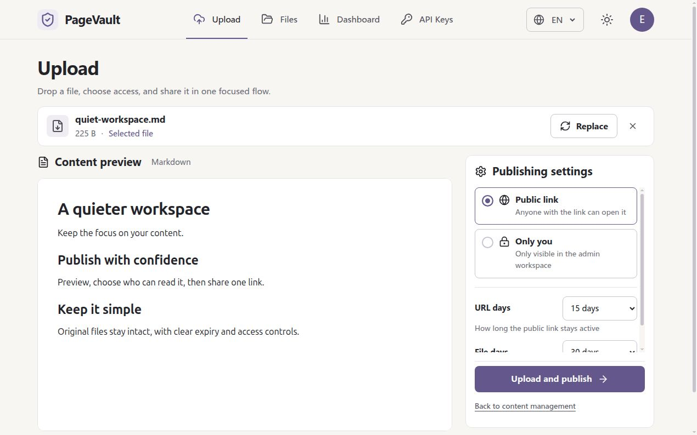

# PageVault

### Turn AI-made pages into links that open anywhere.

[](https://github.com/vdeng-ai/PageVault/actions/workflows/ci.yml)
[](https://github.com/vdeng-ai/PageVault/actions/workflows/docker.yml)
[](./docs/cloudflare-deploy.md)
[](./LICENSE)

[](https://deploy.workers.cloudflare.com/?url=https://github.com/vdeng-ai/PageVault)

Language: English | [简体中文](./README.zh-CN.md)

PageVault is a personal-first, self-hosted publisher for sharing AI-generated HTML, Markdown, PDF, SVG, and image-based infographics in WeChat and other messaging apps. It turns files that are awkward to preview in chat into controlled links that open directly in a browser.

Upload through the web workspace, automate with the upload API, or connect ChatGPT through MCP to save generated files without leaving the conversation.

**Upload once → get a controlled link → paste it into any chat.**

**Cloudflare Free-first:** PageVault is intentionally designed for personal use on the free tiers of Workers, D1, R2, Workers Static Assets, and one Cron Trigger. The project avoids heavy compute, Office conversion, background processing infrastructure, and other features that would push the core deployment beyond that lightweight boundary.

**v1.0 stable baseline:** The A–L roadmap is complete. PageVault now follows SemVer and defaults to maintenance, reliability, security, performance, and small compatible UX improvements rather than continued feature expansion.



English interface · Light theme · Local Markdown preview before publishing.

## Highlights

- **Chat-ready sharing** — Turn HTML, Markdown, PDF, SVG, and images that messaging apps cannot preview into browser-friendly links.
- **Built for AI output** — Share AI-generated interactive pages, reports, documents, and infographics.
- **ChatGPT / MCP uploads** — Save generated or attached files from a conversation, preserving their original bytes. Publish small HTML, Markdown, and SVG text through the same upload service.
- **Upload-only authorization** — Connect with OAuth + PKCE, keep chat uploads private by default, and revoke connections from the admin workspace without deleting saved files.
- **One upload, one link** — Copy a usable link as soon as the upload finishes, without building a website.
- **Personal-first** — A single-admin design without teams, tenants, or complex roles.
- **Controlled access** — Choose public or private visibility, set URL expiry and file retention, disable access, or delete content.
- **Private storage** — Original files are never exposed directly; every public request passes through the PageVault gateway.
- **Deploy your way** — Stay lightweight on Cloudflare's free tier or run the same service with Docker.
- **Deliberately small scope** — HTML, Markdown, PDF, SVG, PNG, JPEG, and WebP only; no DOCX/PPTX conversion, OCR, video processing, or server-side rendering pipeline.

## Markdown diagrams

Use a `mermaid` fenced code block for flowcharts, sequence diagrams, and other Mermaid diagrams:

````markdown

````

Diagrams render in upload previews, authenticated previews, and public readers. The self-hosted renderer loads only when diagrams are present; public diagrams follow the reader theme. Invalid diagrams stay visible as code, and downloads preserve the original Markdown.

## Architecture

PageVault keeps business logic in `packages/core` and uses runtime-specific adapters:

| Runtime    | Application                    | Metadata | Object storage    |
| ---------- | ------------------------------ | -------- | ----------------- |
| Cloudflare | Worker + Workers Static Assets | D1       | Private R2 bucket |
| Docker     | Node.js 22                     | SQLite   | Local files       |

Production uses separate admin and public hostnames. The incoming `Host` header selects the admin workspace or public publishing gateway, while the same service enforces visibility, status, and expiry rules.

## Getting Started

Install [Node.js 22](https://nodejs.org/), then enable the repository-pinned package manager and install dependencies:

```bash
corepack enable
pnpm install
```

Generate the password hash required by both deployment modes:

```bash
pnpm tsx scripts/hash-password.ts
```

Then choose a deployment target:

| Target     | Best for                                       | Guide                                                |
| ---------- | ---------------------------------------------- | ---------------------------------------------------- |
| Cloudflare | Free-tier-friendly runtime with D1 and R2      | [Cloudflare deployment](./docs/cloudflare-deploy.md) |
| Docker     | Self-managed server with SQLite and local disk | [Docker deployment](./docs/docker-deploy.md)         |

For a contributor-oriented local setup, see [CONTRIBUTING.md](./CONTRIBUTING.md).

## Upload from ChatGPT (MCP)

PageVault exposes an optional, stateless Streamable HTTP endpoint at `/mcp` on the **admin hostname**. It reuses the existing Worker, D1, private R2 bucket, and daily Cron; Docker provides the same integration with SQLite and local files. It does not add an AI service, queue, Durable Object, or additional Worker.

### Enable the integration

Deploy PageVault with migrations `0008_mcp_oauth.sql` and `0009_gc_active_expiry.sql` applied before enabling MCP. The existing Cloudflare deployment workflow applies migrations before deployment; Docker applies them at startup.

Add these optional settings to the ignored `apps/worker/.env.production` for a local Cloudflare deployment, the GitHub `production` environment secrets for CI deployment, or the Docker service environment:

```dotenv
MCP_ENABLED=true
MCP_OAUTH_CLIENT_ID=pagevault-chatgpt
MCP_OAUTH_REDIRECT_URIS=https://chatgpt.com/connector_platform_oauth_redirect
```

Use the **exact callback URI shown by your ChatGPT connection setup**; replace the example when necessary. The default is a predefined public OAuth client with mandatory PKCE and no client secret. Confidential clients are also supported; keep their secrets in deployment secrets and the connection's secure credential field, never in a chat or plugin archive. MCP is disabled when `MCP_ENABLED` is unset; set it explicitly to `false` to disable an already enabled installation.

### Connect and upload

1. Sign in to PageVault and open **API Keys → ChatGPT / MCP**. Copy the instance's MCP endpoint; do not use the public sharing hostname or a `workers.dev` preview URL.
2. Add a custom MCP/plugin connection through an account-supported ChatGPT flow with **predefined OAuth client** support. Use the following settings, then sign in with the existing PageVault administrator account and approve upload access.

   | Setting                 | Value                                     |
   | ----------------------- | ----------------------------------------- |
   | MCP endpoint / resource | `https://YOUR_ADMIN_HOST/mcp`             |
   | Transport               | Streamable HTTP                           |
   | Authentication          | OAuth, predefined client                  |
   | Client ID               | Your configured `MCP_OAUTH_CLIENT_ID`     |
   | Client secret           | Leave empty for the default public client |
   | Scope                   | `assets:upload`                           |

   Discovery supplies the authorization and token endpoints. PageVault does not expose dynamic client registration; do not select DCR for this setup.

3. Select PageVault in the conversation and ask it to save or publish the desired file. For example:

   > Save the PDF you just generated privately to PageVault.

   > Publish this HTML to PageVault with a share link valid for 15 days, and retain the original file for 30 days.

Successful public uploads return the share URL and original-file URL. Private uploads return an authenticated admin link, not a public link. Actual visibility and expiry timestamps are included in the result. Revoke access at any time under **API Keys → ChatGPT / MCP**; revocation does not remove previously saved files.

### Tools and limits

| Tool                | Purpose                                                                                                          |
| ------------------- | ---------------------------------------------------------------------------------------------------------------- |
| `get_upload_policy` | Read supported formats, size limits, and default expiry settings without listing stored files.                   |
| `upload_asset`      | Import a host-provided file reference, preserving original bytes; default maximum 10 MiB.                        |
| `publish_text`      | Save small HTML, Markdown, or SVG source; maximum 256 KiB of UTF-8 text and private by default despite the name. |

Supported formats remain HTML, Markdown, PDF, SVG, PNG, JPEG, and WebP. Default link validity is 15 days and file retention is 30 days, subject to instance configuration. Matching retries under the same credential and idempotency key are deduplicated for 24 hours. Tools cannot list assets, read private files, change existing permissions, or delete files.

File uploads require ChatGPT to forward a usable file reference. A `sandbox:` path is not a remote download URL. Single-file uploads do not bundle local images, CSS, or JavaScript dependencies; Office files, videos, ZIP imports, binary Base64 inputs, and format conversion are not supported.

For a portable private-plugin package, run this from the repository root with Node.js and Python 3 installed:

```bash
node scripts/package-chatgpt-plugin.mjs https://YOUR_ADMIN_HOST pagevault-chatgpt none
```

This creates `dist/pagevault-chatgpt.zip` containing public connection settings and an upload skill, not credentials. Import it through a supported private-plugin flow and complete OAuth authorization; the archive does not deploy PageVault.

See the [MCP guide](./docs/mcp.md) for callback configuration, confidential clients, download-host restrictions, troubleshooting, and Cloudflare quota estimates. Platform contracts are documented in OpenAI's [OAuth guide](https://developers.openai.com/plugins/build/auth) and [file-input reference](https://developers.openai.com/plugins/reference#define-file-inputs).

## Documentation

- [Product direction and roadmap](./docs/roadmap.md)
- [v1 upgrade and rollback guide](./docs/upgrading.md)
- [Release process](./docs/releasing.md)
- [Support boundaries](./docs/support.md)
- [Changelog](./CHANGELOG.md)
- [Configuration reference](./docs/configuration.md)
- [Operations and free-tier guardrails](./docs/operations.md)
- [Share compatibility checklist](./docs/share-compatibility.md)
- [Cloudflare deployment](./docs/cloudflare-deploy.md)
- [Docker deployment](./docs/docker-deploy.md)
- [HTTP API](./docs/api.md)
- [ChatGPT / MCP uploads](./docs/mcp.md)
- [Runtime security model](./docs/security.md)
- [Vulnerability reporting](./SECURITY.md)

## Development

The main repository checks are:

```bash
pnpm run typecheck
pnpm run lint
pnpm run test
pnpm run build
```

After building, validate MCP against isolated local workerd, D1, and R2 without writing to production:

```bash
pnpm run test:mcp:worker
```

CI and deployment verification include this smoke check. Browser coverage remains in the separate `e2e/` test project.

See [CONTRIBUTING.md](./CONTRIBUTING.md) for local services, environment setup, and pull request expectations.

## Contributing

Issues and pull requests are welcome. Please read [CONTRIBUTING.md](./CONTRIBUTING.md) before proposing a change. Report security vulnerabilities privately according to [SECURITY.md](./SECURITY.md), not through a public issue.

## License

PageVault is available under the [MIT License](./LICENSE).
