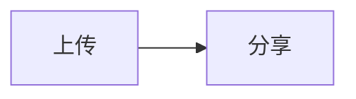

# PageVault

### 把 AI 作品变成一条在微信里也能直接打开的链接。

语言：[English](./README.md) | 简体中文

PageVault 是一个面向个人的自托管发布工具，用于分享 AI 生成的页面、报告、文档和图片。你可以在网页中上传，也可以从 ChatGPT 对话上传文件，或使用上传 API。PageVault 保留原始文件，并生成可在浏览器、微信等聊天软件中打开的分享链接。

**上传文件 → 获得链接 → 分享给别人。**


## 可以用来做什么

- **分享页面与文档**：发布交互 HTML、Markdown、PDF、SVG 和图片，无需搭建完整网站。
- **从 ChatGPT 上传**：保存聊天中可引用的生成文件或附件，直接在对话里取得 PageVault 链接。
- **控制访问与期限**：选择公开或私有，调整链接有效期和文件保留时间，随时停用分享。
- **在线预览与下载**：在浏览器中阅读支持的文件，获取原始内容；Markdown 支持 Mermaid 图表。
- **管理个人内容库**：使用一个管理员账号管理自己的文件，支持中英文界面和明暗主题。

## 默认上传设置

| 设置           | 默认值     |
| -------------- | ---------- |
| 可见性         | **公开**   |
| 分享链接有效期 | **15 天**  |
| 文件保留时间   | **30 天**  |
| 单文件大小上限 | **10 MiB** |

**公开文件可由任何持有链接的人访问。** 仅自己查看的内容，请在网页中选择“私有”，或在 ChatGPT 中明确说“私有保存，不公开”。私有上传返回需要登录的后台查看链接，不会返回公开分享链接。

链接有效期与文件保留时间互相独立。按默认设置，第 15 天后分享链接失效，但管理员仍可在文件保留期内访问；第 30 天后文件不可再访问，并由定时清理删除。上传时可以调整这两个期限，也可以在文件仍保留时到后台修改。管理员可以配置不同的实例默认值；已上传文件继续使用各自原有的设置。

## 在网页中上传

1. 登录 PageVault 管理页面，打开上传页面，拖入文件或从设备中选择文件。
2. 查看预览和发布设置。直接使用默认值，即为公开、链接有效 15 天、文件保留 30 天；也可以选择私有或自定义期限。
3. 上传成功后，复制分享链接，粘贴到聊天窗口或发送给需要查看的人。

需要在线预览时使用**分享链接**，需要原始内容时使用**原文件链接**。两种链接都受文件的可见性与有效期控制。

## 从 ChatGPT 对话上传

### 首次连接

在 PageVault 中打开 **API Keys → ChatGPT / MCP**，复制 MCP 地址和 Client ID。实例需要先启用 MCP；管理员可参照[连接设置说明](./docs/mcp.md#configure-before-enabling)完成配置。

在 ChatGPT 支持预配置 OAuth 客户端的自定义 MCP／插件连接入口中添加 PageVault：

| 配置项        | 填写内容                                                                     |
| ------------- | ---------------------------------------------------------------------------- |
| MCP 地址      | 从 PageVault 后台复制的地址                                                  |
| 传输方式      | Streamable HTTP                                                              |
| 认证方式      | OAuth                                                                        |
| Client ID     | PageVault 后台显示的值                                                       |
| Client Secret | 标准公共客户端留空；仅在管理员配置了密钥时，通过连接界面的安全凭据输入框填写 |
| Scope         | `assets:upload`                                                              |

按提示登录 PageVault 并同意上传授权。不要把密码或 API Key 粘贴进聊天。连接后，在对话中选择 PageVault，再提出上传请求。

新连接授权默认有效 **365 天**，实际期限以授权页面显示为准。访问令牌最长 1 小时，可在授权期内自动刷新，也可随时撤销。旧的 30 天连接保留原到期时间，重新授权后才使用新期限。连接授权与链接有效 15 天、文件保留 30 天互相独立。

### 直接这样说

使用默认设置：

> 把这个文件上传到 PageVault，把分享链接给我。

仅自己查看：

> 把这个文件私有保存到 PageVault，不要公开分享。

自定义期限：

> 把这份报告发布到 PageVault，链接有效 7 天，文件保留 60 天。

上传成功后会返回实际可见性、到期时间，以及分享链接或需要登录的后台链接。文件引用不可用或已经过期时，请重新附加或选择文件，不要用本地文件路径代替附件。

已有连接升级后，请刷新工具定义，避免继续沿用旧版“默认私有”的行为。通过私有插件包安装的连接，还需要更新包内的上传说明。明确指定“私有”的请求始终保持私有。

可在 **API Keys → ChatGPT / MCP** 撤销连接，撤销只会阻止后续工具访问，不会删除已保存文件。ChatGPT 上传工具不能浏览你的内容库、读取私有文件或删除资产。

## 管理已经上传的内容

在管理页面中按标题、文件名、格式、状态或日期查找文件。打开文件后，可以预览、复制链接、重命名、切换公开／私有、调整到期时间、停用分享或删除。私有文件需要管理员登录后预览；将文件改为私有会阻止公开访问。

需要从其他应用上传时，在 **API Keys** 页面创建仅上传密钥，按页面内的使用说明或[上传 API 指南](./apps/admin/public/upload-api.md)接入。请妥善保管密钥，并撤销不再使用的密钥。

## 支持的文件

| 内容类型      | 格式                             |
| ------------- | -------------------------------- |
| 交互页面      | `.html`、`.htm`                  |
| Markdown 文档 | `.md`、`.markdown`               |
| PDF 文档      | `.pdf`                           |
| 矢量图片      | `.svg`                           |
| 普通图片      | `.png`、`.jpg`、`.jpeg`、`.webp` |

Markdown 中使用 `mermaid` 代码块即可编写图表：

````markdown

````

每次上传保存一个文件，不会自动导入 HTML 引用的本地图片、CSS 或 JavaScript。请使用自包含页面，或引用已经可访问且在有效期内的资源链接。不支持 Office 文档、视频、ZIP 网站包或格式转换。

## 部署自己的 PageVault

可按 [Cloudflare 使用与部署指南](./docs/cloudflare-deploy.md)或 [Docker 使用与部署指南](./docs/docker-deploy.md)配置自己的实例。Cloudflare 适合轻量个人使用，实际费用取决于账户用量与存储规模；修改实例默认设置可查看[配置说明](./docs/configuration.md)。

PageVault 基于 [MIT License](./LICENSE) 开源。
