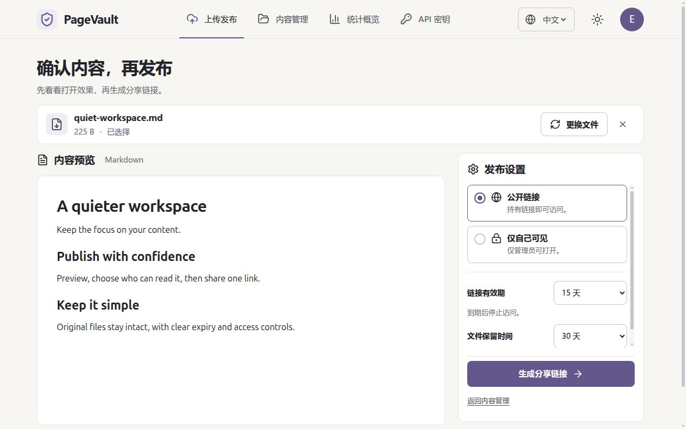
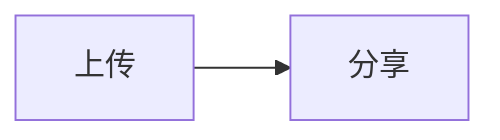

# PageVault

### 把 AI 作品变成一条在微信里也能直接打开的链接。

[](https://github.com/vdeng-ai/PageVault/actions/workflows/ci.yml)
[](https://github.com/vdeng-ai/PageVault/actions/workflows/docker.yml)
[](./docs/cloudflare-deploy.md)
[](./LICENSE)

[](https://deploy.workers.cloudflare.com/?url=https://github.com/vdeng-ai/PageVault)

语言：[English](./README.md) | 简体中文

PageVault 是一个为个人使用设计的自托管发布工具，用于在微信和其他聊天软件中分享 AI 生成的 HTML、Markdown、PDF、SVG 和图片信息图。它把不便在聊天窗口中直接预览的文件转换为可以在浏览器中一键打开的可控链接。

你可以通过网页工作台上传、使用上传 API 自动化发布，也可以通过 MCP 接入 ChatGPT，在对话中直接保存生成的文件。

**上传内容 → 生成可控链接 → 粘贴到任意聊天窗口。**

**Cloudflare Free-first：** PageVault 明确面向个人使用，核心部署长期以 Workers、D1、R2、Workers Static Assets 和一个 Cron Trigger 的免费层为约束。项目主动避免重计算、Office 转换、复杂后台任务基础设施，以及会让核心部署变重的功能。

**v1.0 稳定基线：** A–L 路线图已经完成。此后 PageVault 按 SemVer 维护，默认优先正确性、安全、可靠性、性能和小型兼容改进，不再持续扩张产品边界。



中文界面 · 浅色主题 · Markdown 发布前本地预览。

## 核心功能

- **Chat-ready sharing** — 把 IM 软件无法直接预览的 HTML、Markdown、PDF、SVG 和图片转换为浏览器链接。
- **Built for AI output** — 适合分享 AI 生成的交互页面、报告、说明文档和信息图。
- **ChatGPT / MCP 聊天上传** — 在对话中保存生成文件或附件，保留原始字节；也可通过同一上传服务保存小型 HTML、Markdown 和 SVG 文本。
- **仅上传授权** — 通过 OAuth + PKCE 连接，聊天上传默认私有；可在后台随时撤销连接，不删除已经保存的文件。
- **One upload, one link** — 上传完成即可复制链接，无需建立完整网站。
- **Personal-first** — 单管理员设计，没有复杂的团队、租户和权限体系。
- **Controlled access** — 支持公开或私有、链接过期、文件保留期限、停用和删除。
- **Private storage** — 原始文件不直接公开，所有访问统一经过 PageVault 网关。
- **Deploy your way** — 可长期保持轻量运行在 Cloudflare 免费层，也支持 Docker。
- **Deliberately small scope** — 仅支持 HTML、Markdown、PDF、SVG、PNG、JPEG 和 WebP；不规划 DOCX/PPTX 转换、OCR、视频处理或服务端渲染流水线。

## Markdown 图表

使用 `mermaid` 代码块编写流程图、时序图等 Mermaid 图表：

````markdown

````

上传预览、登录后的文件预览和公开分享页均支持图表。渲染器随站点部署，仅在存在图表时加载；公开图表跟随阅读主题切换。语法错误的图表保留为代码，下载内容始终是原始 Markdown。

## 架构

PageVault 将业务逻辑集中在 `packages/core`，并为不同运行环境提供适配器：

| 运行环境   | 应用                           | 元数据 | 对象存储       |
| ---------- | ------------------------------ | ------ | -------------- |
| Cloudflare | Worker + Workers Static Assets | D1     | 私有 R2 bucket |
| Docker     | Node.js 22                     | SQLite | 本地文件       |

生产环境使用相互独立的管理端和公开访问主机名。服务根据请求的 `Host` header 选择管理界面或公开发布网关，并统一执行可见性、状态和过期时间检查。

## 开始使用

安装 [Node.js 22](https://nodejs.org/)，然后启用仓库固定版本的包管理器并安装依赖：

```bash
corepack enable
pnpm install
```

生成两种部署方式都需要的管理员密码哈希：

```bash
pnpm tsx scripts/hash-password.ts
```

然后选择部署方式：

| 目标       | 适用场景                             | 指南                                           |
| ---------- | ------------------------------------ | ---------------------------------------------- |
| Cloudflare | 可从免费层级起步的 D1 和 R2 托管环境 | [Cloudflare 部署](./docs/cloudflare-deploy.md) |
| Docker     | 使用 SQLite 和本地磁盘的自管理服务器 | [Docker 部署](./docs/docker-deploy.md)         |

面向贡献者的本地开发流程请参阅 [CONTRIBUTING.md](./CONTRIBUTING.md)。

## 通过 ChatGPT 上传（MCP）

PageVault 在**管理域名**的 `/mcp` 路径提供可选的无状态 Streamable HTTP 接口，复用原有 Worker、D1、私有 R2 和每日 Cron。Docker 使用 SQLite 与本地文件提供相同能力，不新增 AI 服务、队列、Durable Objects 或额外 Worker。

### 启用集成

部署 PageVault，并在启用 MCP 前应用 `0008_mcp_oauth.sql` 和 `0009_gc_active_expiry.sql`。现有 Cloudflare 部署工作流会先迁移再部署，Docker 会在启动时应用迁移。

根据部署方式，把以下可选配置添加到本地 Cloudflare 部署使用的、被 Git 忽略的 `apps/worker/.env.production`，GitHub 的 `production` 环境 Secrets，或 Docker 服务环境变量中：

```dotenv
MCP_ENABLED=true
MCP_OAUTH_CLIENT_ID=pagevault-chatgpt
MCP_OAUTH_REDIRECT_URIS=https://chatgpt.com/connector_platform_oauth_redirect
```

回调地址必须与 **ChatGPT 连接设置显示的完整地址精确一致**；实际地址不同时请替换示例。默认使用预配置的公共 OAuth 客户端，强制 PKCE，不需要 Client Secret。也支持机密客户端，但密钥只能放在部署 Secrets 和连接界面的安全凭据输入框中，不要发送到聊天或写入插件包。未设置 `MCP_ENABLED` 时默认关闭；关闭已启用的实例时，应显式设置为 `false`。

### 连接与上传

1. 登录 PageVault，打开 **API Keys → ChatGPT / MCP**，复制当前实例的 MCP 地址。不要使用公开分享域名或 `workers.dev` 预览地址。
2. 使用当前 ChatGPT 账号支持的自定义 MCP／私有插件入口，选择**预配置 OAuth 客户端**，填写下列参数，再通过现有 PageVault 管理员账号登录并允许上传。

   | 设置               | 值                               |
   | ------------------ | -------------------------------- |
   | MCP 地址／Resource | `https://YOUR_ADMIN_HOST/mcp`    |
   | 传输方式           | Streamable HTTP                  |
   | 认证方式           | OAuth，预配置客户端              |
   | Client ID          | 实例配置的 `MCP_OAUTH_CLIENT_ID` |
   | Client Secret      | 默认公共客户端留空               |
   | Scope              | `assets:upload`                  |

   授权与令牌端点由发现接口提供。PageVault 不提供动态客户端注册接口，此配置不要选择 DCR。

3. 在对话中选择 PageVault，明确指出要保存或公开发布的文件，例如：

   > 把刚才生成的 PDF 私有保存到 PageVault。

   > 把这份 HTML 发布到 PageVault，分享链接有效 15 天，原文件保留 30 天。

公开上传成功后会返回分享链接与原文件链接；私有上传只返回需要登录的后台链接，不会返回公开链接。结果还包含实际可见性和到期时间。可随时在 **API Keys → ChatGPT / MCP** 撤销授权，撤销不会删除已经保存的文件。

### 工具与限制

| 工具                | 用途                                                                                        |
| ------------------- | ------------------------------------------------------------------------------------------- |
| `get_upload_policy` | 查询支持格式、大小限制与有效期默认值，不列出已保存文件。                                    |
| `upload_asset`      | 接收宿主提供的文件引用，保留原始字节；单文件默认上限 10 MiB。                               |
| `publish_text`      | 保存小型 HTML、Markdown 或 SVG 源文本；UTF-8 上限 256 KiB，名称虽含 publish，默认仍为私有。 |

格式范围仍为 HTML、Markdown、PDF、SVG、PNG、JPEG、WebP。链接默认有效 15 天，文件默认保留 30 天，以实例配置为准。同一凭据和幂等键下的相同请求可在 24 小时内安全重试，不重复创建文件。工具不能列出资产、读取私有文件、修改已有权限或删除文件。

文件上传需要 ChatGPT 转交可用的文件引用，`sandbox:` 路径不是远程下载地址。单文件上传不会自动打包本地图片、CSS、JavaScript 依赖；不支持 Office 文件、视频、ZIP 导入、二进制 Base64 参数或格式转换。

需要便携私有插件包时，在已安装 Node.js 和 Python 3 的环境中，从仓库根目录执行：

```bash
node scripts/package-chatgpt-plugin.mjs https://YOUR_ADMIN_HOST pagevault-chatgpt none
```

生成的 `dist/pagevault-chatgpt.zip` 只包含公开连接配置与上传技能，不包含凭据。通过支持的私有插件入口导入后仍需完成 OAuth 授权；插件包不会自动部署 PageVault。

回调配置、机密客户端、下载域名限制、故障排查和 Cloudflare 配额估算请参阅 [MCP 使用指南](./docs/mcp.md)。平台接口约定见 OpenAI 的 [OAuth 文档](https://developers.openai.com/plugins/build/auth)和[文件参数文档](https://developers.openai.com/plugins/reference#define-file-inputs)。

## 文档

- [产品方向与路线图](./docs/roadmap.md)
- [v1 升级与回滚](./docs/upgrading.md)
- [发布流程](./docs/releasing.md)
- [支持边界](./docs/support.md)
- [更新日志](./CHANGELOG.md)
- [配置参考](./docs/configuration.md)
- [Cloudflare 部署](./docs/cloudflare-deploy.md)
- [Docker 部署](./docs/docker-deploy.md)
- [HTTP API](./docs/api.md)
- [ChatGPT / MCP 聊天上传与配额规划](./docs/mcp.md)
- [运行时安全模型](./docs/security.md)
- [漏洞报告方式](./SECURITY.md)

详细技术与协作文档统一使用英文维护，以避免双份文档长期产生差异。

## 开发

仓库的主要检查命令如下：

```bash
pnpm run typecheck
pnpm run lint
pnpm run test
pnpm run build
```

构建完成后，可在隔离的本地 workerd、D1、R2 上验证 MCP，不写入生产资源：

```bash
pnpm run test:mcp:worker
```

CI 和部署前验证已包含此冒烟检查，浏览器测试仍放在独立的 `e2e/` 测试项目中。

本地服务、环境配置和 Pull Request 要求请参阅 [CONTRIBUTING.md](./CONTRIBUTING.md)。

## 参与贡献

欢迎提交 Issue 和 Pull Request。提出改动前，请先阅读 [CONTRIBUTING.md](./CONTRIBUTING.md)。安全漏洞必须按照 [SECURITY.md](./SECURITY.md) 私下报告，请勿创建公开 Issue。

## 许可证

PageVault 基于 [MIT License](./LICENSE) 开源。
